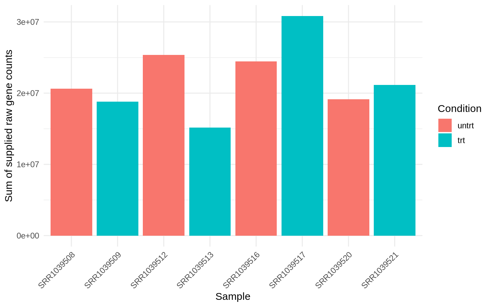
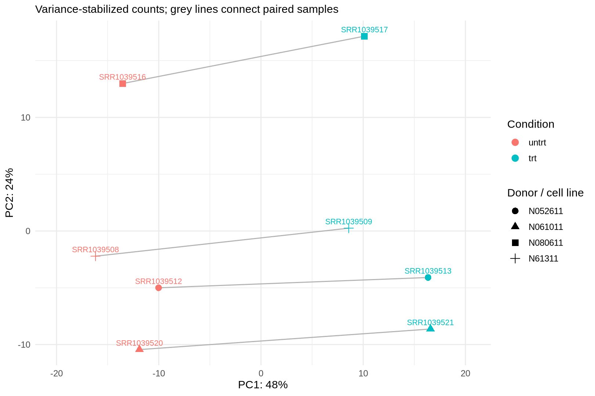
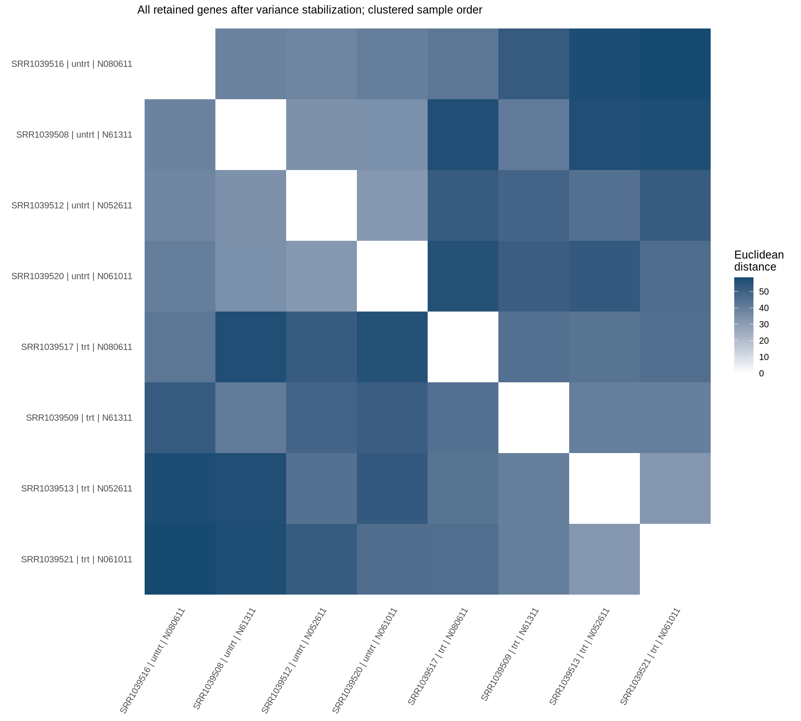
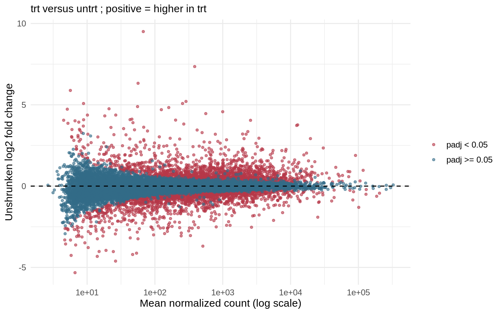
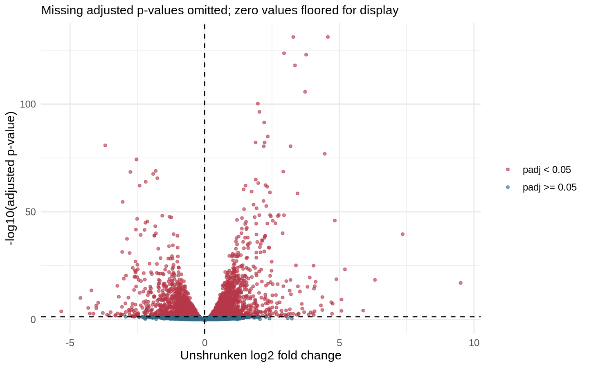
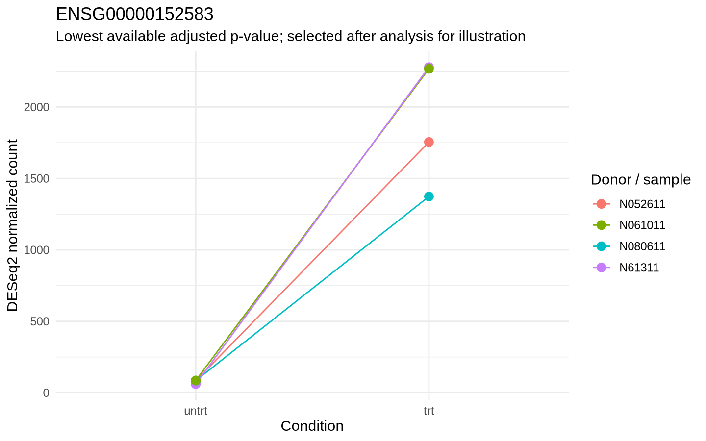

# Preview: Airway case study

Start by exploring the prepared results from the real airway experiment. **If the prepared project results are present, you can view them before running analysis.** Later, you will check the inputs, reproduce the same figures and verify selected numbers.

The project’s saved preview figures and supporting tables belong in `results/airway/`. These results are generated by `scripts/R/run_workflow.R`, which is also used for your practice run. Quarto displays the saved images; rendering does not fit DESeq2.

**Comparison direction:** positive log2 fold changes mean higher expression in trt relative to untrt, accounting for cell line. Check this against `run-log.txt` before interpreting a gene.

## Library sizes

Each bar sums the supplied raw gene counts for one sample. Unequal totals motivate normalization; they do not describe overall FASTQ or alignment quality.

## PCA

Each point is a sample; colour shows condition and shape shows donor or cell line. Grey lines connect paired samples. Axis labels give the variation explained. PCA uses up to 500 most variable genes after variance stabilization. Donor variation remains visible: including donor in the fitted model does not remove it from these transformed counts.

## Sample-distance heatmap

Each tile is a Euclidean distance between two samples, using all retained variance-stabilized genes. Darker tiles indicate larger distances. Rows and columns follow hierarchical clustering; diagonal distances are zero. Compare both treatment and donor labels.

## MA plot

Each point is a retained gene with a finite fold-change estimate. The horizontal axis is the mean normalized count on a log scale; the vertical axis is the unshrunken log2 fold change. Colours distinguish adjusted p-values below 0.05, other available values and unavailable values. Low-count estimates may be unstable.

## Volcano plot

Each point has a finite fold-change estimate and an available adjusted p-value. The vertical axis is -log10(adjusted p-value), so higher points have smaller adjusted p-values. The dashed horizontal line marks 0.05. Missing adjusted p-values are omitted; numerical zeros are floored for display. The plot uses unshrunken effects and does not impose an effect-size cutoff.

## Selected-gene expression

Each point is a DESeq2 normalized count; lines connect the same donor or cell line across conditions. The title names the gene with the lowest available adjusted p-value (ties follow the saved result order); if none is available, the highest mean normalized count is used. Selection happens after analysis and is illustrative. Normalized counts adjust for size factors; they do not remove donor effects or independently validate the model.

## Reference values to check against your run

The supplied reference run has **8 samples**. Its first sample, `SRR1039508`, has **20,637,971 supplied counts** and **24633 detected genes**. PC1 explains **47.7%** and PC2 **23.5%** of the variation used for PCA.

The selected-gene figure shows `ENSG00000152583`, with an estimated log2 fold change of **4.574** and adjusted p-value **7.32e-132** for trt versus untrt, accounting for cell line. Trace these values to the tables when you reach verification. These are reference values reported in the supplied guide; use your own recorded outputs after rerunning or changing inputs.

## Check your understanding

1. Which samples are paired, and where can you see those pairs?
2. Does a PCA separation identify statistically significant genes?
3. Which direction does a positive log2 fold change represent?
4. Why might a large fold change have weak statistical evidence?
5. Why is a selected-gene plot not an independent confirmation of its adjusted p-value?

Airway gene identifiers refer to the supplied annotation. Gene names, functions and mechanisms require a documented annotation source and supporting evidence.

## Your evidence note

For each figure, record one observation, the supporting table or axis and one limit. A figure selected or generated from the fitted result is a display of that analysis, not an independent experiment. Missing images mean the saved outputs need to be generated; Quarto does not fit DESeq2 while rendering.

[Next: Meet the data](02-meet-the-data.qmd)
