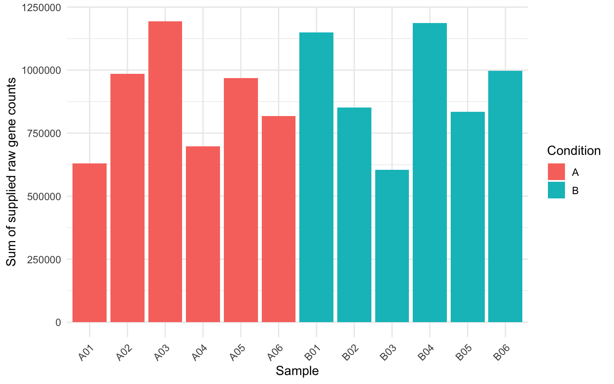
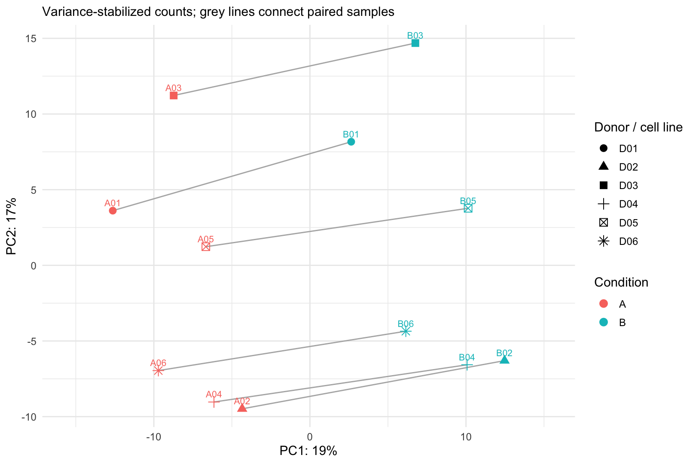
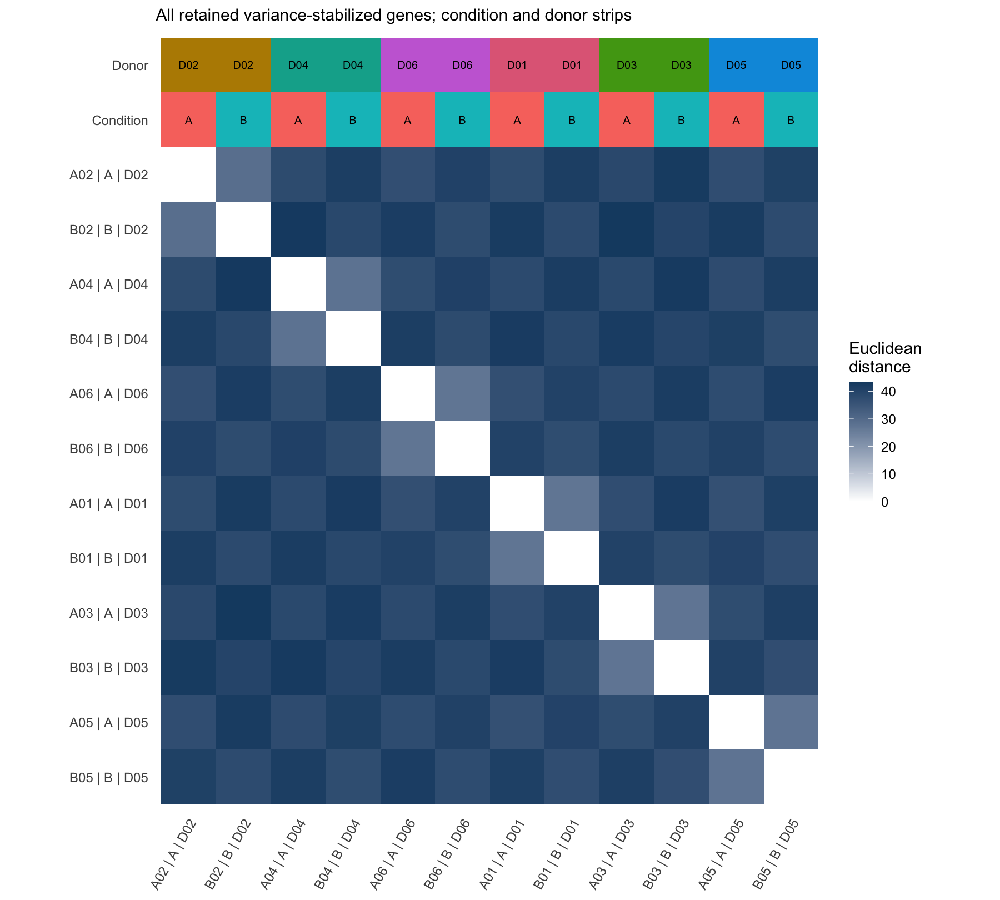
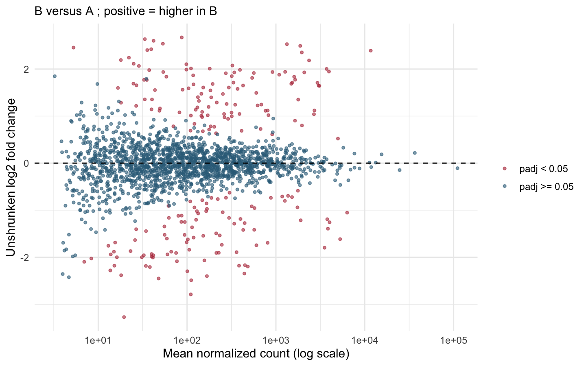
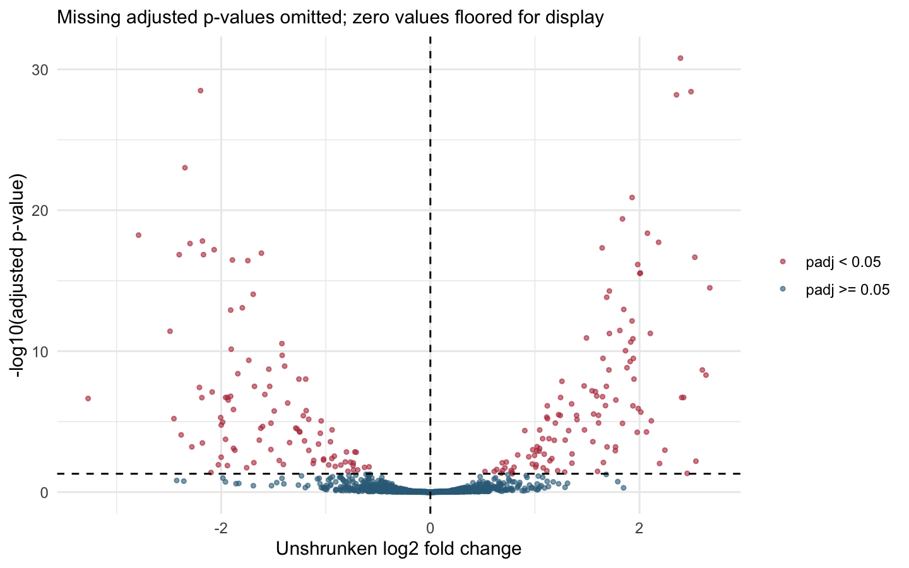
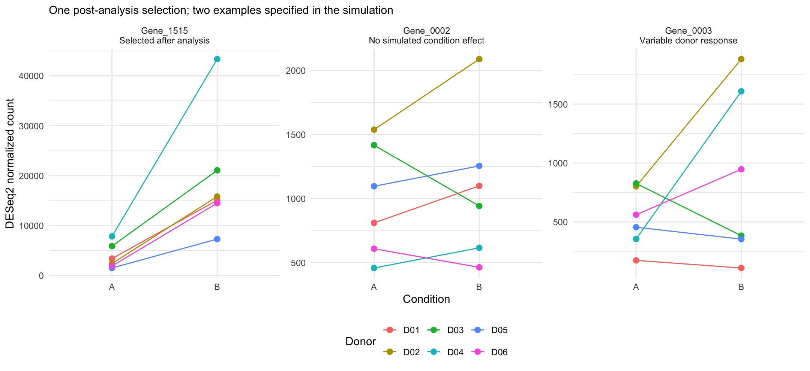

# See the result

Start by exploring the prepared results from the fictional paired experiment. **You can view these figures before running any analysis.** Later, you will check the inputs, reproduce the same figures and verify selected numbers.

The preview figures and supporting tables are bundled in `results/synthetic/`. They were generated by `scripts/R/run_workflow.R`, which is also used for your practice run. Quarto displays the saved images; rendering does not fit DESeq2.

**Comparison direction:** positive log2 fold changes mean higher expression in B relative to A. Check this against `run-log.txt` before interpreting a gene.

## Library sizes

Each bar sums the supplied raw gene counts for one sample. Unequal totals motivate normalization; they do not describe overall FASTQ or alignment quality.

## PCA

Each point is a sample; colour shows condition and shape shows donor or cell line. Grey lines connect paired samples. Axis labels give the variation explained. PCA uses up to 500 most variable genes after variance stabilization. Donor variation remains visible: including donor in the fitted model does not remove it from these transformed counts.

## Sample-distance heatmap

Each tile is a Euclidean distance between two samples, using all retained variance-stabilized genes. Darker tiles indicate larger distances. Rows and columns follow hierarchical clustering; diagonal distances are zero. The two annotation strips identify donor and condition. In this bundled simulation, donor pairs sit next to each other in the clustered order: donor variation remains important even with a condition effect. Compare both treatment and donor labels.

## MA plot

Each point is a retained gene with a finite fold-change estimate. The horizontal axis is the mean normalized count on a log scale; the vertical axis is the unshrunken log2 fold change. Colours distinguish adjusted p-values below 0.05, other available values and unavailable values. Low-count estimates may be unstable.

## Volcano plot

Each point has a finite fold-change estimate and an available adjusted p-value. The vertical axis is -log10(adjusted p-value), so higher points have smaller adjusted p-values. The dashed horizontal line marks 0.05. Missing adjusted p-values are omitted; numerical zeros are floored for display. The plot uses unshrunken effects and does not impose an effect-size cutoff.

## Selected-gene expression

Each point is a DESeq2 normalized count; lines connect the same donor or cell line across conditions. The three panels show the gene with the lowest available adjusted p-value, a prespecified gene with no simulated condition effect, and a prespecified gene with variable donor response. The latter two were chosen before fitting, using `plot-examples.tsv`. “No simulated effect” describes the generating parameter; its observed counts and fitted effect can still differ between conditions. Each panel has its own vertical scale. The first gene is selected after analysis and is illustrative. Normalized counts adjust for size factors; they do not remove donor effects or independently validate the model.

## Numbers to locate in the bundled results

This version has **2,000 fictional genes** and **12 samples from six paired donors**. A01 has **629,417 supplied counts** and **1935 detected genes**. After filtering, **1,839 genes** are retained in the DE result. Compare input gene count, detected genes for one sample, retained genes and genes with available adjusted p-values: they are different quantities.

PC1 explains **19.4%** and PC2 **16.7%** of variation among the 500 genes used for PCA. The retained genes used for the distance heatmap are a larger set, so the two displays need not emphasize identical patterns.

The post-analysis selected gene is `Gene_1515`, with estimated log2 fold change **2.391** and adjusted p-value **1.6e-31**, for B relative to A while accounting for donor. Its large, consistent change is only one example. Compare it with `Gene_0002` (no simulated condition effect) and `Gene_0003` (variable donor response), whose panels use separate vertical scales.

These values identify the bundled run; after changing inputs or software, report your own checked outputs. All labels and generating effects are fictional.

## Check your understanding

1. Which samples are paired, and where can you see those pairs?
2. Does a PCA separation identify statistically significant genes?
3. Which direction does a positive log2 fold change represent?
4. Why might a large fold change have weak statistical evidence?
5. Why is a selected-gene plot not an independent confirmation of its adjusted p-value?

All gene labels and effects here are fictional. Do not assign real biological mechanisms to them.

[Next: Meet the data](02-meet-the-data.qmd)
