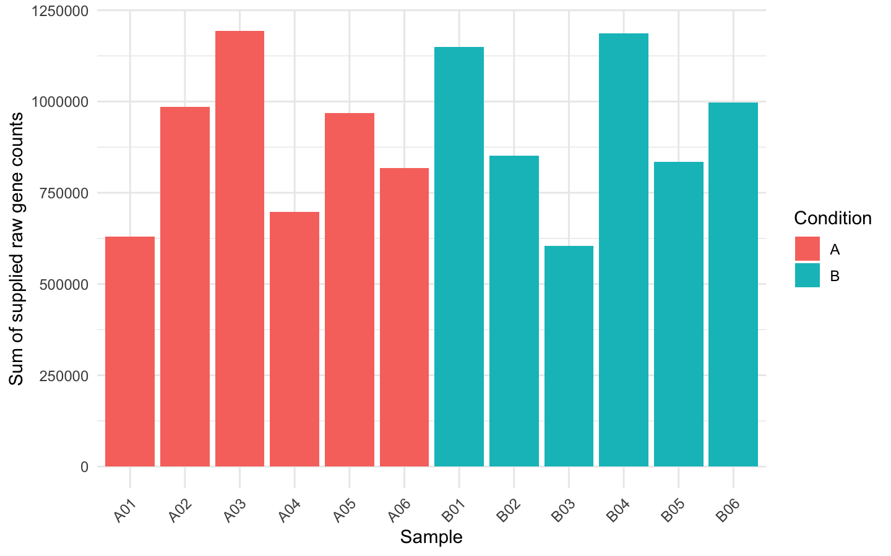
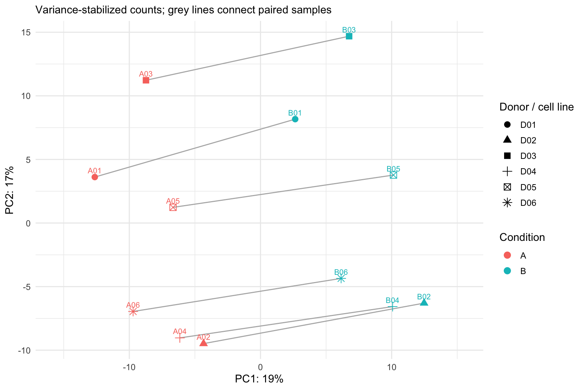
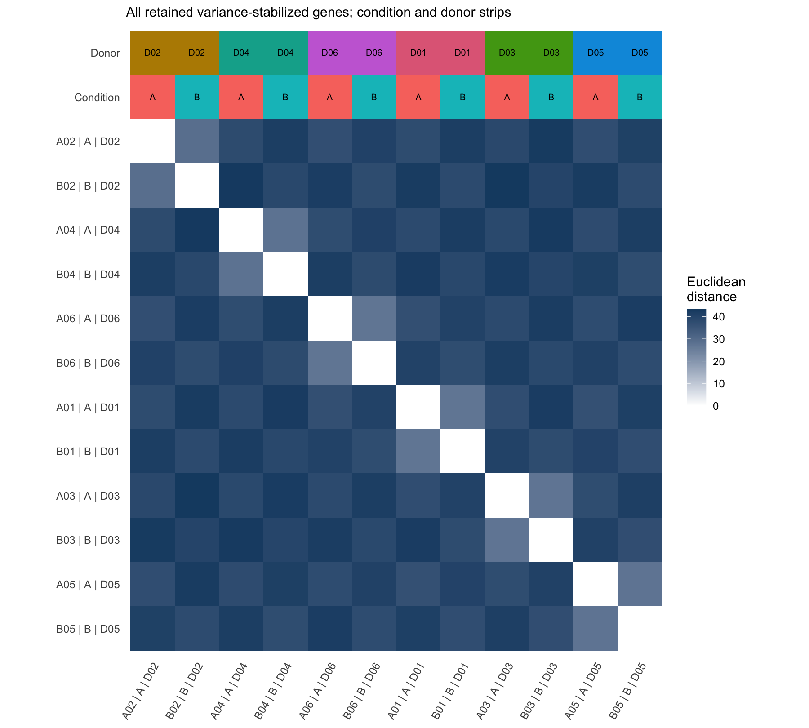
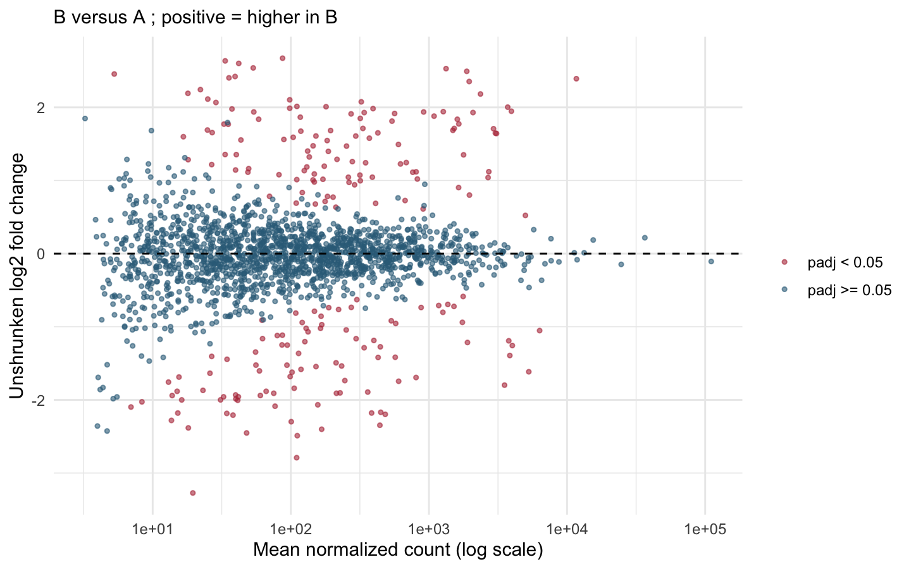
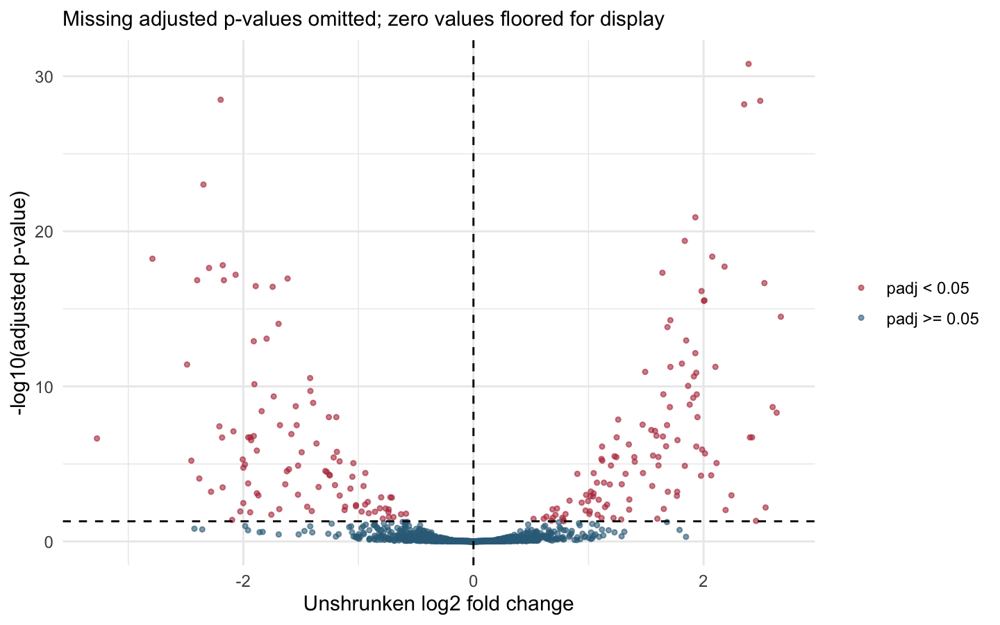
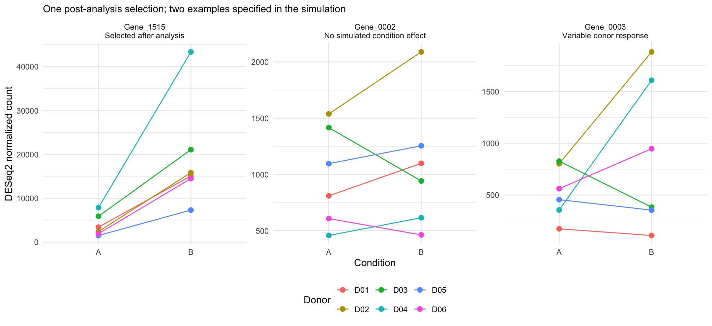

## Question and inputs

Which fictional genes differ between group B and group A?

The input consists of 2,000 invented gene rows and 12 fictional samples,
six per group, with the same six donors measured in both conditions. [Confirm these counts from your files.]

## Methods

I checked the count matrix and metadata, then fitted the supplied DESeq2
model `~ donor + group` with B versus A as the contrast. Genes were kept when they
had at least 10 counts in at least two samples. [Add R and DESeq2 versions
from results/synthetic/run-log.txt and the number of genes tested.]

## Verification

For A01, the count total was [number] and [number] genes had nonzero counts.
I recalculated both from gene-counts.tsv and [state agreement with sample-qc.tsv].

## Results

[Describe the library sizes using checked numbers and state a limitation.]

[Describe the pca using checked numbers and state a limitation.]

[Describe the sample-distance heatmap using checked numbers and state a limitation.]

[Describe the ma plot using checked numbers and state a limitation.]

[Describe the volcano plot using checked numbers and state a limitation.]

[Compare the selected gene, the prespecified null-effect gene and the variable-response gene. Quote checked model estimates and normalized counts. Distinguish generating parameters from fitted estimates; note that panel scales differ.]

## Interpretation and limits

These data are fictional. The plot is exploratory; the gene table reflects
its chosen model and contrast. No claim about a real biological process or
clinical treatment follows from these results.

## Reproducibility

Inputs: data/synthetic/.
Outputs: results/synthetic/.
[Record your run date, exact command and source version.]
